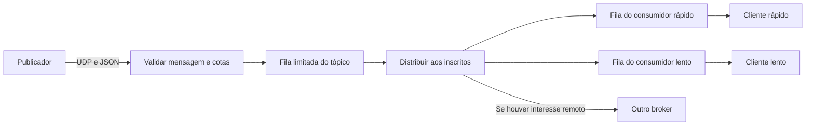

# Núcleo do broker UDP

O broker recebe publicações e as distribui aos clientes inscritos em cada tópico. Esta versão segue o documento simplificado v3. A implementação anterior em WebSocket permanece no histórico do PR #3; este documento descreve seu funcionamento após a migração para UDP.

## Caminho de uma mensagem



1. O broker verifica o tamanho, o JSON, o tópico e os limites de tráfego.
2. Se há inscritos locais ou interesse do outro broker, coloca a publicação na fila do tópico. Sem inscritos conhecidos, descarta e avisa o publicador.
3. O despachante do tópico coloca uma entrega na fila de cada consumidor. Essa etapa não espera o consumidor processar a mensagem.
4. Cada consumidor tem seu próprio envio com taxa ajustável. Se a fila encher, saem as mensagens mais antigas e os descartes são contados por tópico.
5. Quando necessário, uma cópia segue para o outro broker, que entrega apenas aos seus inscritos, sem repassar de volta.

## O que foi mantido e adaptado do núcleo anterior

- Filas separadas para tópico e consumidor, descarte das mensagens antigas e isolamento do consumidor lento.
- Confirmação dos comandos administrativos, avisos de descarte e publicações sem confirmação positiva.
- Contadores, encerramento por sinal e verificações de publicação, inscrição, cancelamento e exclusão.
- Os dois testes de ordem/concorrência da fila foram adaptados em internal/fila/compatibilidade_test.go. O benchmark de inserção para vários destinos foi adaptado em internal/broker/bench_test.go.

As estruturas específicas da conexão WebSocket foram substituídas pelas sessões identificadas por endpoint UDP. A lista de inscritos usa cópia sob mutex para simplificar a implementação. Os limites das filas agora incluem bytes e quantidade de mensagens. O ajuste de taxa e a detecção de falha usam mensagens de atividade e estado.

## Execução

```sh
go run ./cmd/broker -endereco 127.0.0.1:8080
go run ./cmd/demo -modo estatisticas -brokers 127.0.0.1:8080
```

As estatísticas usam o próprio protocolo UDP, por ESTATISTICAS. Não há endpoint HTTP /contadores nesta versão. Execute cada comando em um terminal diferente. Para dois brokers, consumidor lento e demonstração interativa, siga o README.md. As flags completas aparecem em:

```sh
go run ./cmd/broker -h
```

## Verificação e limites

```sh
go test ./...
go test -run '^$' -bench BenchmarkFanout -benchtime 100x -benchmem ./internal/broker
```

O benchmark mede apenas inserção nas filas com descarte do mais antigo. Não usa rede nem mede a capacidade total do broker. Os números anteriores de WebSocket não são resultados da versão UDP.

UDP pode perder mensagens. Filas limitadas também podem descartar mensagens. A troca de broker tem interrupção e não recupera publicações antigas. O ambiente previsto é uma rede local acadêmica com participantes conhecidos. Consulte PROTOCOL.md e VALIDACAO.md para os parâmetros e a validação realizada.
