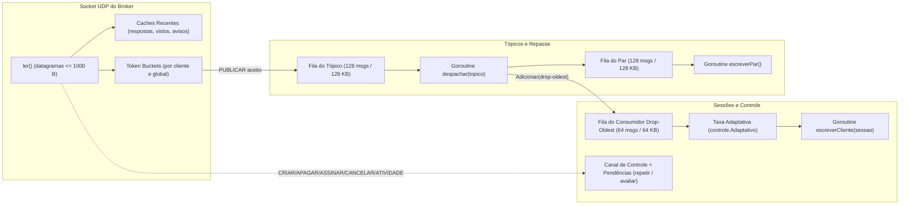

# Arquitetura do Broker (Cenário C — Proposta Simplificada v3)

Este documento detalha a implementação do núcleo do broker (`internal/broker` e `cmd/broker`) segundo o [documento de projeto simplificado v3](docs/documento-projeto-v3.md): transporte **UDP com mensagens JSON de até 1.000 bytes**, **filas limitadas por quantidade e por bytes**, **confirmações com deduplicação em memória recente**, **ajuste adaptativo de taxa com tetos** e **repasse direto entre até dois brokers**.

---

## 1. Visão geral e arquitetura interna

O broker opera sobre um único socket UDP (`*net.UDPConn`) e mantém todo o seu estado em memória (`Broker`), sem variáveis globais:

- **Goroutine leitora (`ler`):** recebe cada datagrama UDP, valida o JSON (`protocol.Decodificar`, limite de 1.000 bytes), separa mensagens do broker par (`receberPar`), confirmações de avisos (`RECEBIDO`), batimentos de atividade (`ATIVIDADE`), comandos administrativos (`CRIAR_TOPICO`, `APAGAR_TOPICO`, `ASSINAR`, `CANCELAR`, `ESTATISTICAS`) e publicações (`PUBLICAR`).
- **Tópicos e despachantes (`topico` / `despachar`):** cada tópico possui uma fila de entrada (`fila.Fila[entrega]`) limitada por quantidade de mensagens (padrão `128`) e por bytes (padrão `128.000`), além de uma goroutine despachante própria que retira as publicações aceitas e as distribui para as filas dos inscritos locais e, quando há interesse remoto recente, para a fila do broker par (`filaPar`).
- **Sessões de clientes (`sessao` / `escreverCliente`):** cada endpoint cliente possui uma fila de saída independente limitada por mensagens (padrão `64`) e por bytes (padrão `64.000`) com política **drop-oldest** (quando cheia, remove as entregas mais antigas para dar lugar à mais recente) e uma goroutine escritora dedicada regulada por `controle.Adaptativo`.
- **Canal de controle (`escreverControle`) e manutenção (`manter`):** respostas e avisos administrativos saem por uma fila dedicada com orçamento próprio (`controleSaida`). Avisos importantes (`SEM_INSCRITOS`, `TOPICO_APAGADO`, `DESCARTADAS`, `RATE_LIMIT`, `TOPICO_SOBRECARREGADO`, `CRIAR_REMOTO`, `APAGAR_REMOTO`) recebem um número de `aviso` e são reenviados periodicamente até receberem `RECEBIDO` ou atingirem o limite de tentativas.



---

## 2. Operações, confirmações e memória recente

| Operação recebida | Comportamento no broker |
|---|---|
| `CRIAR_TOPICO` | Cria o tópico se não existir (respeitando `MaxTopicos`), guarda a resposta `OK` no cache de comandos recentes (`CacheRespostas`) por `(endpoint, cliente, id)` e propaga `CRIAR_REMOTO` confiável ao broker par. |
| `APAGAR_TOPICO` | Cancela o despachante do tópico, limpa sua fila e remove entregas pendentes daquele tópico nas filas dos inscritos, envia aviso confiável `ERRO` (`TOPICO_APAGADO`) aos inscritos e propaga `APAGAR_REMOTO` ao par. |
| `ASSINAR` | Cria o tópico caso ainda não exista (comunicando `CRIAR_REMOTO` ao par na criação), registra a sessão entre os inscritos, responde `OK` (cacheado para repetições) e anuncia o interesse atualizado (`INTERESSE`) ao par. |
| `CANCELAR` | Remove a sessão da lista de inscritos do tópico, limpa entregas pendentes daquele tópico na fila da sessão, responde `OK` (idempotente) e atualiza o anúncio de interesse ao par. |
| `PUBLICAR` | Descarta silenciosamente duplicatas recentes (`CacheVistos` por `cliente:id`); valida cota do cliente e entrada global (`RATE_LIMIT` se exceder); verifica existência do tópico (`TOPICO_INEXISTENTE`) e presença de inscritos locais ou interesse remoto ativo (`SEM_INSCRITOS`); enfileira no tópico ou recusa com `TOPICO_SOBRECARREGADO`. |
| `ATIVIDADE` | Atualiza métricas de recepção/envio da sessão, recalcula a taxa adaptativa de saída do consumidor (`AvaliarComDemanda`) e devolve `ESTADO` ao cliente com o teto de publicação permitido e indicador de pressão de fila. |
| `RECEBIDO` | Confirma e remove um aviso confiável pendente (`pendentes[addr:aviso]`), encerrando suas retransmissões. |
| `ESTATISTICAS` | Devolve `OK` com o JSON de `Broker.Estatisticas()` (contadores de tráfego, descartes, duplicatas, repasses e ocupação de filas). |

---

## 3. Dois brokers e repasse sem ciclos

1. **Lista fixa de até dois brokers (`-endereco` e `-par`):** cada instância conhece o endereço UDP do seu par.
2. **Anúncio periódico e sob demanda (`INTERESSE`):** sempre que uma inscrição muda (`ASSINAR` / `CANCELAR`) e a cada ciclo de manutenção (`-intervalo`), o broker informa ao par quantos inscritos locais possui em cada tópico. O interesse remoto expira se não for renovado dentro de `-inatividade`.
3. **Sincronização de ciclo de vida (`CRIAR_REMOTO` / `APAGAR_REMOTO`):** confirmada com `RECEBIDO` e deduplicada em `CacheAvisos`.
4. **Repasse em um único salto (`REPASSE`):** apenas publicações originadas de clientes locais (`e.m.Tipo != protocol.TipoRepasse`) são encaminhadas para `filaPar` quando há interesse remoto ativo. Ao receber um `REPASSE` do par, o broker de destino valida o orçamento `entradaPar`, deduplica em `CacheVistos` e enfileira no tópico local apenas para entrega aos seus inscritos locais — **nunca repassa de volta**.

---

## 4. Controle de tráfego, filas e descarte

- **Proteção de entrada:** cada identificador de cliente possui um `controle.Bucket` cujo teto é repartido igualmente entre os publicadores ativos ($\min(\text{TaxaCliente}, \text{TaxaEntrada} / N_{\text{ativos}})$), além do bucket global `entrada` e dos orçamentos separados `controleEntrada` e `entradaPar` (repasses de dados nunca consomem fichas administrativas).
- **Filas duplamente limitadas (itens e bytes):** tanto a fila do tópico (`128` itens / `128.000` bytes) quanto a fila de cada consumidor (`64` itens / `64.000` bytes) e a fila do par usam `internal/fila`, que controla simultaneamente quantidade de mensagens, soma de bytes e picos históricos (`PicoItens`, `PicoBytes`).
- **Isolamento de consumidor lento:** na fila do consumidor, `Adicionar(..., descartarAntigos=true)` remove as mensagens mais antigas quando o limite de itens ou de bytes é atingido, contabiliza o descarte por tópico em `s.descartes[topico]` e, no ciclo de manutenção, envia o aviso confiável `DESCARTADAS` com a quantidade descartada no período. Além disso, o ritmo de envio ao consumidor é ajustado por `controle.Adaptativo` a partir dos relatórios de `ATIVIDADE` (reduz pela metade sob fila $\ge 50\%$ ou perdas seguidas; sobe $10\%$ após duas avaliações boas seguidas com demanda, até o teto).

---

## 5. Flags do executável `cmd/broker`

```sh
go run ./cmd/broker [flags]
```

| Flag | Padrão | Descrição |
|---|---|---|
| `-endereco` | `127.0.0.1:8080` | Endereço UDP local de escuta |
| `-par` | `""` | Endereço UDP do segundo broker (opcional) |
| `-id` | endereço local | Identificador do broker incluído no campo `origem` |
| `-teto-cliente` | `100` | Publicações/s por identificador de cliente e teto de entrega por consumidor |
| `-teto-entrada` | `2000` | Publicações/s aceitas no total (incluindo repasses) |
| `-teto-saida` | `5000` | Datagramas/s totais de saída (incluindo controle) |
| `-teto-controle` | `200` | Datagramas/s de controle por sentido |
| `-teto-par` | `1000` | Repasses/s entre brokers por sentido |
| `-rajada` | `4` | Fichas iniciais e capacidade de rajada por token bucket |
| `-fila-topico` / `-bytes-topico` | `128` / `128000` | Limite de mensagens e bytes na fila de cada tópico |
| `-fila-cliente` / `-bytes-cliente` | `64` / `64000` | Limite de mensagens e bytes na fila de saída de cada consumidor |
| `-max-clientes` / `-max-topicos` | `256` / `128` | Limite de sessões UDP simultâneas e de tópicos em memória |
| `-max-pendencias` | `512` | Limite de avisos confiáveis aguardando confirmação `RECEBIDO` |
| `-cache-respostas` / `-cache-vistos` / `-cache-avisos` | `2048` / `8192` / `2048` | Capacidade dos caches de deduplicação em memória recente |
| `-validade-cache` | `20s` | Tempo de retenção das entradas nos caches recentes |
| `-intervalo` / `-inatividade` | `1s` / `5s` | Período de manutenção/anúncios e prazo de expiração de sessão/interesse |
| `-repeticao` / `-tentativas` | `300ms` / `3` | Intervalo de reenvio e máximo de tentativas para avisos confiáveis |
| `-metricas` / `-intervalo-metricas` | `""` / `200ms` | Caminho opcional para exportar CSV de CPU, RAM residente e ocupação de filas |

---

## 6. Verificação

```sh
go test -race ./...
go vet ./...
go build ./...
go test -run '^$' -bench BenchmarkFanout -benchmem ./internal/broker
```
