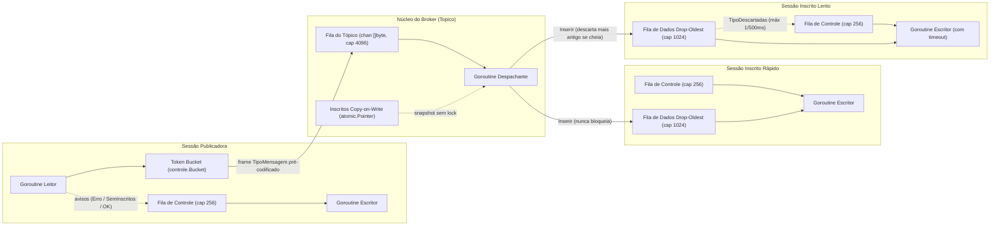
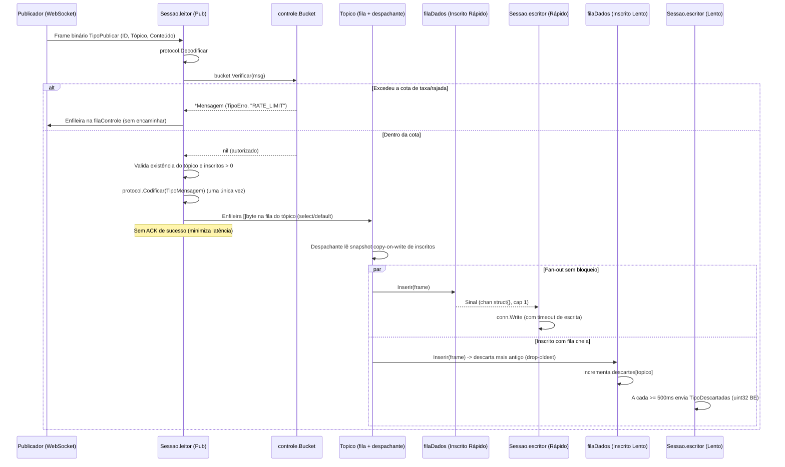

# Parte 1 — Núcleo do Broker (Cenário C: Interação ao Vivo)

Este documento descreve a arquitetura, o contrato de mensagens, as decisões de projeto (tradeoffs) e a operação do núcleo do broker (`internal/broker` e `cmd/broker`) para o **Cenário C — Interação ao Vivo** (leilões, jogos interativos, reações em eventos ao vivo).

No Cenário C, **descartar uma mensagem antiga é preferível a atrasar uma mensagem nova**: um espectador lento não pode degradar a latência dos espectadores rápidos nem bloquear o publicador, e só deve ser desconectado se sua conexão travar de fato.

---

## 1. Visão geral e arquitetura

Cada conexão WebSocket aceita em `/ws` é encapsulada numa `Sessao` com **duas goroutines dedicadas** (`leitor` e `escritor`) e **duas filas limitadas** (`filaControle` e `filaDados`). Cada `Topico` criado dinamicamente possui uma **fila limitada de publicações** (para absorver rajadas) e **uma goroutine despachante** que realiza o fan-out para as filas de dados dos inscritos usando uma lista *copy-on-write* (`atomic.Pointer[[]*Sessao]`).



---

## 2. Fluxo de uma publicação

O diagrama de sequência abaixo mostra o caminho completo de uma publicação aceita, desde a leitura do frame até a entrega a um inscrito rápido e a um inscrito lento:



---

## 3. Contrato de operações e formato das respostas

### 3.1 Respostas síncronas por operação

Todas as respostas a comandos do cliente preservam o mesmo `ID` da requisição original (exceto erros de frame ilegível, que usam `ID = 0`):

| Recebido do cliente | Condição | Resposta do broker | `Conteudo` |
|---|---|---|---|
| `TipoCriarTopico` (4) | Tópico novo | `TipoOK` (17) | vazio |
| `TipoCriarTopico` (4) | Tópico já existe (idempotente) | `TipoOK` (17) | vazio |
| `TipoCriarTopico` (4) | Nome vazio (`""`) | `TipoErro` (18) | `"TOPICO_INVALIDO"` |
| `TipoApagarTopico` (5) | Tópico existe | `TipoOK` (17) + aviso aos inscritos | vazio |
| `TipoApagarTopico` (5) | Tópico não existe (idempotente) | `TipoOK` (17) | vazio |
| `TipoAssinar` (2) | Tópico existe | Registra inscrição e **depois** `TipoOK` (17) | vazio |
| `TipoAssinar` (2) | Tópico não existe | `TipoErro` (18) | `"TOPICO_INEXISTENTE"` |
| `TipoCancelar` (3) | Inscrito ou não (idempotente) | `TipoOK` (17) | vazio |
| `TipoPublicar` (1) | Recusado pelo token bucket | `TipoErro` (18) | `"RATE_LIMIT"` |
| `TipoPublicar` (1) | Tópico não existe | `TipoErro` (18) | `"TOPICO_INEXISTENTE"` |
| `TipoPublicar` (1) | Tópico sem inscritos | `TipoSemInscritos` (19) | vazio |
| `TipoPublicar` (1) | Fila do tópico cheia | `TipoErro` (18) | `"TOPICO_SOBRECARREGADO"` |
| `TipoPublicar` (1) | Aceito com inscritos | **Sem ACK** ao publicador; `TipoMensagem` (16) aos inscritos | payload original |
| Frame texto ou corrompido | Falha em `protocol.Decodificar` ou `MessageText` | `TipoErro` (18) com `ID = 0` (mantém conexão) | `"FRAME_INVALIDO"` |
| Tipo 16–20 ou desconhecido | Enviado pelo cliente | `TipoErro` (18) | `"TIPO_DESCONHECIDO"` |

### 3.2 Avisos espontâneos do broker (`ID = 0`)

- **Tópico apagado:** ao receber `TipoApagarTopico` para um tópico existente, cada inscrito daquele tópico recebe um frame `TipoErro` (`18`) com `ID = 0`, `Topico` igual ao nome do tópico apagado e `Conteudo` igual a `"TOPICO_APAGADO"`.
- **Descarte por consumidor lento (`TipoDescartadas = 20`):** quando a fila circular de dados de um inscrito descarta mensagens antigas (*drop-oldest*), o escritor da sessão envia no máximo um aviso por tópico a cada `500 ms` com:
  - `Tipo`: `protocol.TipoDescartadas` (`20`)
  - `ID`: `0`
  - `Topico`: nome do tópico em que houve descarte
  - `Conteudo`: **4 bytes (`uint32` big-endian)** contendo a quantidade de entregas descartadas naquele tópico para aquela sessão desde o último aviso enviado.

---

## 4. Decisões de projeto e tradeoffs (Cenário C)

| Decisão | O que se ganha (Cenário C) | O que se perde (Tradeoff assumido) |
|---|---|---|
| **5.1 Leitor e escritor separados por sessão** | Um inscrito cujo socket bloqueia na escrita trava apenas a sua própria goroutine escritora; o despachante do tópico e os demais espectadores continuam operando sem interferência. | Duas goroutines por conexão ativa em vez de uma. |
| **5.2 Duas filas por sessão: controle (canal 256) e dados (buffer circular 1024 *drop-oldest*)** | Respostas de controle (`TipoOK`, `TipoErro`, `TipoDescartadas`) têm prioridade sobre o fluxo de dados. Quando o consumidor atrasa, descartar o item mais antigo (*drop-oldest*) entrega sempre o estado mais fresco (último lance, reação atual). | Consumidores lentos sofrem lacunas na sequência de mensagens (sinalizadas via `TipoDescartadas`). |
| **5.3 Fila limitada (4096) e despachante por tópico** | Absorve rajadas intensas de publicações sem bloquear a leitura do publicador; isola o custo de fan-out em dois níveis de buffer (tópico → inscrito). | Uma goroutine adicional por tópico ativo e descarte explícito (`TOPICO_SOBRECARREGADO`) se a rajada superar a capacidade da fila do tópico. |
| **5.4 Codificação única do frame `TipoMensagem`** | O leitor do publicador chama `protocol.Codificar` uma única vez e compartilha o slice `[]byte` imutável entre todos os inscritos (zero alocações por inscrito no fan-out). | O ID da mensagem entregue é o mesmo enviado pelo publicador (não renumerado por inscrito). |
| **5.5 Lista de inscritos *copy-on-write* (`atomic.Pointer`)** | O despachante lê o snapshot de inscritos com uma única carga atômica, sem disputar mutex com inscrições ou cancelamentos. | `Assinar` e `Cancelar` alocam uma nova cópia do slice de inscritos do tópico (operações raras frente a `Publicar`). |
| **5.6 Operações de controle idempotentes e `Publicar` sem ACK** | Reconexões automáticas da biblioteca cliente podem reenviar `Assinar` ou `CriarTopico` sem erro espúrio; não enviar ACK em `Publicar` reduz pela metade o tráfego de quadros no caminho crítico. | O publicador não recebe confirmação positiva por mensagem entregue (adequado ao Cenário C, onde confiabilidade individual não é crítica). |
| **5.7 Timeout por escrita (5 s) sem ping/pong agressivo** | Como `internal/client` para de ler o socket quando o canal `Eventos()` (256 posições) enche, um ping/pong derrubaria espectadores legítimos porém lentos. O timeout apenas na escrita mantém vivos os lentos que ainda drenam o socket e desconecta clientes realmente mortos/travados. | Detecção de conexão silenciosamente morta sem tráfego depende da próxima tentativa de escrita naquela sessão. |
| **5.8 Estado 100% em memória** | Latência sub-milissegundo sem I/O de disco no caminho crítico. | Reiniciar o broker apaga tópicos e inscrições (mitigado pela reconexão e reinscrição automática da Parte 2). |

---

## 5. Flags, execução e contadores do núcleo

### 5.1 Como executar e flags disponíveis

```sh
go run ./cmd/broker [flags]
```

| Flag | Padrão | Descrição |
|---|---|---|
| `-addr` | `:8080` | Endereço TCP/HTTP de escuta (serve `/ws` e `/contadores`) |
| `-fila-assinante` | `1024` | Capacidade do buffer circular de dados por inscrito (*drop-oldest*) |
| `-fila-controle` | `256` | Capacidade da fila de controle por sessão |
| `-fila-topico` | `4096` | Capacidade da fila de publicações de cada tópico |
| `-taxa` | `100` | Taxa de reposição do token bucket por sessão (publicações/s) |
| `-rajada` | `200` | Capacidade máxima de rajada do token bucket por sessão |
| `-timeout-escrita` | `5s` | Tempo limite para cada chamada `Write` no WebSocket |
| `-origens` | `*` | Padrões de `Origin` aceitos no handshake WebSocket (separados por vírgula) |

Ao receber `SIGINT` ou `SIGTERM`, o broker encerra todas as sessões enviando `websocket.StatusGoingAway` e aguarda o término de todas as goroutines.

### 5.2 Janela de leitura dos contadores (`GET /contadores`)

O endpoint `GET http://localhost:8080/contadores` devolve um JSON com os contadores atômicos do núcleo:

- `conexoes_ativas`: sessões WebSocket abertas no momento;
- `topicos_ativos`: tópicos existentes no momento;
- `publicacoes_recebidas`: total de frames `TipoPublicar` recebidos;
- `publicacoes_rejeitadas_rate_limit`: publicações barradas por `bucket.Verificar`;
- `publicacoes_sem_inscritos`: publicações descartadas com aviso `TipoSemInscritos`;
- `publicacoes_topico_inexistente`: publicações em tópicos não criados (`TOPICO_INEXISTENTE`);
- `publicacoes_descartadas_fila_topico`: publicações recusadas porque a fila do tópico estava cheia (`TOPICO_SOBRECARREGADO`);
- `entregas_enfileiradas`: entregas inseridas nas filas de dados dos inscritos;
- `entregas_escritas`: frames `TipoMensagem` efetivamente escritos no socket dos inscritos;
- `entregas_descartadas_consumidor_lento`: entregas antigas removidas por *drop-oldest* nas filas de inscritos lentos;
- `avisos_controle_descartados`: avisos de controle descartados por fila de controle cheia;
- `sessoes_encerradas_timeout_escrita`: sessões desconectadas por estourar `-timeout-escrita`;
- `topicos[<nome>]`: objeto com `inscritos`, `publicacoes`, `descartes` e `ocupacao_fila` daquele tópico.

---

## 6. Limitações conhecidas

1. **Múltiplas instâncias não coordenadas pelo núcleo:** a biblioteca cliente (`internal/client`) suporta lista de URLs com failover e reinscrição automática, mas cada instância de `Broker` mantém seus próprios tópicos e inscritos em memória local, sem federação nem replicação entre processos. Todo o estado do `Broker` está isolado na struct `broker.Broker` (sem variáveis globais), não impedindo evolução futura.
2. **Reinscrição após failover em tópico dinâmico:** quando um broker cai e o cliente reconecta em outra instância recém-iniciada, a biblioteca cliente reenvia apenas `TipoAssinar`. Se o tópico ainda não tiver sido criado na nova instância, é necessário criá-lo antes que as inscrições sejam aceitas.
3. **Limite de taxa por conexão:** conforme documentado em `PARTE3.md`, o `controle.Bucket` é instanciado uma vez por conexão WebSocket; abrir múltiplas conexões ou reconectar restaura a cota de rajada.

---

## 7. Números de benchmark e smoke test

### Ambiente de medição

- **Sistema Operacional:** Windows 10 (`windows/amd64`)
- **CPU:** Intel(R) Core(TM) i5-3320M CPU @ 2.60GHz (4 threads)
- **Versão do Go:** `go1.27.3 windows/amd64`

### Benchmark de fan-out (`go test -bench=BenchmarkFanout -benchmem ./internal/broker`)

Payload de 128 bytes (frame total de 147 bytes), pré-codificado uma vez e enfileirado para 10, 100 e 1000 inscritos:

```text
goos: windows
goarch: amd64
pkg: github.com/Luizalima3/middleware-pubsub-go/internal/broker
cpu: Intel(R) Core(TM) i5-3320M CPU @ 2.60GHz
BenchmarkFanout/inscritos_10-4         	 1291039	       926.4 ns/op	1586.76 MB/s	       0 B/op	       0 allocs/op
BenchmarkFanout/inscritos_100-4        	  120454	     10119 ns/op	1452.74 MB/s	       0 B/op	       0 allocs/op
BenchmarkFanout/inscritos_1000-4       	   11119	    133240 ns/op	1103.28 MB/s	      18 B/op	       0 allocs/op
```

### Isolamento de consumidor lento (`TestConsumidorLentoIsoladoEDescartadas`)

- **Sem `-race`:** consumidor rápido recebeu 200/200 mensagens de 32 KiB com **p50 = 36,3 µs** e **p99 = 2,29 ms**, enquanto o consumidor lento que parou de ler teve 54 entregas descartadas por *drop-oldest* e recebeu `TipoDescartadas = 54` ao retomar a leitura.
- **Com `-race`:** consumidor rápido recebeu 200/200 mensagens com **p50 = 6,61 ms** e **p99 = 49,67 ms**, `TipoDescartadas = 54`.

### Smoke test (`cmd/broker` + `cmd/demo` + `cmd/carga`)

- Demonstração (`evento/reacoes` com 1 publicador a cada 10 ms, 1 espectador rápido e 1 espectador com `-atraso 200ms`): 363 publicações recebidas, 726 entregas enfileiradas e escritas sem bloqueio do espectador rápido.
- Gerador de carga (`cmd/carga` com 2 publicadores, 5 assinantes, taxa 20 msg/s por 1 s): **40 escritas, 200 entregas únicas, 0 ausentes, 0 puladas, p99 = 15,176 ms**.
