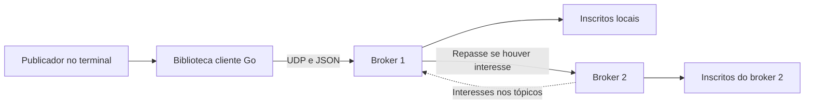
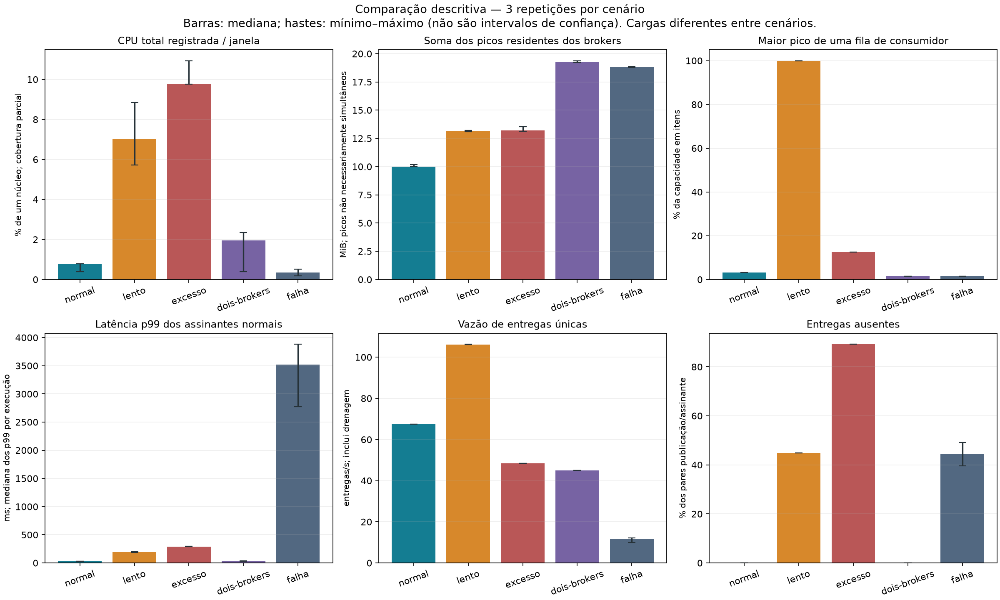

# Middleware Publish/Subscribe — Cenário C

Programa acadêmico em Go para distribuir mensagens de um evento ao vivo. Por exemplo: um participante publica **“Gol!”** no tópico `jogo/reacoes`, e os espectadores inscritos nesse tópico recebem a mensagem. Quem publica não precisa conhecer cada espectador.

A aplicação funciona **no terminal**, usa **UDP com JSON** e trabalha com **até dois brokers conhecidos**, em uma rede local controlada. A prioridade é manter mensagens recentes e limitar o acúmulo. Isso envolve aceitar perdas durante sobrecarga.

Este README descreve a implementação e os resultados. O [documento simplificado v3](docs/documento-projeto-v3.md), de 05/11/2026, foi preservado como proposta da Etapa 1; seus trechos no futuro descrevem o plano daquela etapa.

**Para consultar a entrega:** [resumo para o grupo](experimentos/resultados/RESUMO-PARA-O-GRUPO.md) · [análise e gráficos](experimentos/resultados/README.md) · [como repetir os experimentos](experimentos/README.md).

## Como funciona



O broker verifica a mensagem e os limites de tráfego, coloca a publicação na fila do tópico e distribui entregas às filas dos inscritos. Cada consumidor tem seu próprio envio. Quando a fila de um consumidor enche, sai a mensagem mais antiga; quando a fila do tópico enche, a nova publicação é recusada.

Os brokers anunciam os tópicos com inscritos. Uma publicação pode ser repassada ao único par configurado, que entrega aos seus clientes e **não repassa de volta**. Criação e exclusão de tópicos também são comunicadas. A administração de tópicos deve ser sequencial na demonstração, sem mudanças concorrentes nos dois brokers.

Tópicos, inscrições, filas e registros recentes ficam em memória. Reiniciar o broker perde seu estado local; mensagens antigas não são recuperadas.

## Protocolo e operações

Cada datagrama contém um objeto JSON UTF-8 de até **1.000 bytes completos**, incluindo os campos de controle. Não há fragmentação na aplicação. O tópico pode ter até 80 bytes e o identificador do cliente até 64 bytes. Conteúdo é texto UTF-8; mensagens inválidas ou maiores que o limite são recusadas.

```json
{"tipo":"PUBLICAR","id":42,"cliente":"ana","topico":"jogo/reacoes","conteudo":"Gol!"}
```

| Operação | O que faz |
| --- | --- |
| `CRIAR_TOPICO` | Cria o tópico; se já existir, confirma sucesso. |
| `APAGAR_TOPICO` | Remove o tópico e suas inscrições, libera filas e avisa os inscritos. |
| `ASSINAR` | Inscreve o endpoint do cliente; cria o tópico se necessário. |
| `CANCELAR` | Remove a inscrição daquele endpoint e suas entregas pendentes no tópico. |
| `PUBLICAR` | Solicita a distribuição aos inscritos locais e ao par, se houver interesse. |
| `ATIVIDADE` / `ESTADO` | Troca atividade, ocupação de fila, contadores e taxa permitida. |
| `ESTATISTICAS` | Consulta os contadores agregados do broker. |

Criar, apagar, assinar e cancelar recebem `OK` ou `ERRO`. Há um comando administrativo pendente por cliente. Sem confirmação, o pedido é repetido com o mesmo ID e no mesmo broker, com tentativas limitadas. O broker guarda respostas recentes para reconhecer repetições. Se um comando enviado continuar sem confirmação, a biblioteca pode retornar `ErrResultadoDesconhecido`: ele pode ter sido executado.

Publicações não têm confirmação positiva nem reenvio automático. O sucesso de `Publicar` significa apenas que a escrita UDP local ocorreu. Sem inscritos locais nem interesse remoto conhecido, o broker descarta a publicação e avisa com `SEM_INSCRITOS`. Avisos importantes usam confirmação `RECEBIDO` e repetição limitada; se todas as tentativas falharem, o aviso pode não chegar.

O cliente reconhece publicações repetidas em um cache recente. `Duplicadas()` conta as eliminadas antes de `Eventos()`, e `Descartadas()` conta descartes da fila local. O gerador separa essas duplicatas das que ele próprio detecta; o total é a soma das etapas.

## Controle de tráfego e filas

O envio usa token bucket: as fichas limitam o ritmo e uma pequena rajada. A taxa pode mudar, mas alterar a taxa não renova as fichas disponíveis.

| Situação | Regra implementada |
| --- | --- |
| Pressão na fila, sinais repetidos de perda ou falta de feedback recente | Reduzir a taxa pela metade, respeitando o piso interno. |
| Duas avaliações boas seguidas, com demanda e taxa abaixo do teto | Aumentar 10%, sem ultrapassar o teto. |
| Situação estável no teto | Manter a taxa. |

O ajuste é usado no envio de publicações e nas entregas por consumidor. O cliente respeita seu teto local e o teto informado pelo broker. O broker também confere limites por identificador, limites globais de entrada/saída e orçamentos para controle e repasse. Excesso de publicação é recusado com `RATE_LIMIT`.

| Parâmetro padrão do broker | Valor |
| --- | --- |
| Publicações por cliente | 100/s |
| Entrada global, incluindo repasses | 2.000 publicações/s |
| Saída global, incluindo controle | 5.000 datagramas/s |
| Controle / repasse por sentido | 200 / 1.000 datagramas/s |
| Rajada por orçamento | 4 fichas |
| Fila por tópico | 128 mensagens e 128.000 bytes |
| Fila por consumidor no broker | 64 mensagens e 64.000 bytes |
| Atividade do cliente / manutenção do broker | 1 segundo, por padrão |

Os valores de filas e taxas são configuráveis. A repartição dos tetos é conservadora; não há garantia de justiça perfeita nem redistribuição ótima de orçamento ocioso. O lote de experimentos usa os valores específicos da [configuração registrada](experimentos/resultados/configuracao.json), que diferem de alguns padrões acima.

## Dois brokers e recuperação

A biblioteca recebe um ou dois endereços e escolhe um broker. Como UDP não avisa sozinho que um processo caiu, cliente e broker trocam mensagens de atividade. Quando a comunicação válida deixa de chegar, o cliente tenta o outro endereço e reenvia as inscrições confirmadas antes de considerar a conexão ativa.

Entre rodadas sem sucesso, as tentativas usam espera crescente e pequena variação aleatória. Um pedido administrativo em andamento termina no endereço original; não é transferido automaticamente ao outro broker, pois os caches não são compartilhados.

Essa recuperação pode ter interrupção e perdas. O par de brokers não usa consenso nem replica o estado completo. Falhas ou partições podem deixar tópicos e interesses temporariamente diferentes.

## Relação com os sete requisitos do documento v3

| Requisito | Como aparece na implementação |
| --- | --- |
| 1. Mensagens com tópico | Toda publicação identifica o assunto em `topico`. |
| 2. Publicar, assinar e cancelar | A biblioteca e o cliente interativo oferecem as três operações. |
| 3. Criar e apagar tópicos em execução | Comandos administrativos confirmados, com comunicação ao par. |
| 4. Sem inscritos: descartar e avisar | Descarte com `SEM_INSCRITOS`, confirmação do aviso e tentativas limitadas. |
| 5. Encaminhar aos inscritos e apagar | Tentativa de envio aos inscritos conhecidos; referências liberadas após envio local ou descarte. Escrita UDP não confirma consumo. |
| 6. Absorver rajadas por tópico | Fila de tópico limitada por quantidade e bytes, além das filas por consumidor. |
| 7. Mais de um broker, transparente ao cliente | Dois endereços, repasse direto e reconstrução das inscrições pela biblioteca. |

Os [testes do broker](internal/broker/broker_test.go) e os [testes do cliente](client/client_test.go) verificam operações, avisos, repasse e recuperação. A interpretação do requisito 5 como **tentativa de envio**, aceitando perda de UDP e descarte sob sobrecarga, continua sendo um ponto a validar com o professor. Entrega garantida exigiria mecanismos adicionais.

## Escolhas: o que ganhamos e o que perdemos

| Escolha | Ganho | Custo |
| --- | --- | --- |
| UDP | Dispensa conexão e retransmissão automática das publicações. | Pode perder, duplicar e reordenar mensagens. |
| JSON legível | Facilita explicar o protocolo e investigar erros. | Usa mais bytes e processamento que um formato binário compacto. |
| Filas limitadas e descarte das antigas | Controla o acúmulo e prioriza mensagens recentes. | Consumidores podem perder mensagens. |
| Taxa adaptativa com teto | Ajusta o ritmo e protege o broker do excesso. | Depende do feedback e da calibração dos parâmetros. |
| Dois brokers em memória | Mantém o escopo pequeno e permite repasse e recuperação. | Reinícios perdem estado; falhas podem causar interrupções e divergência temporária. |

## Executar a demonstração

É necessário **Go 1.23 ou superior**. Os executáveis Go não usam dependências externas. Execute os comandos na raiz do repositório, em terminais separados.

Terminal 1, broker:

```sh
go run ./cmd/broker -endereco 127.0.0.1:8080
```

Terminal 2, espectador:

```sh
go run ./cmd/demo -modo assistir -topico jogo/reacoes
```

Terminal 3, publicador:

```sh
go run ./cmd/demo -modo publicar -topico jogo/reacoes -mensagem "Gol!" -intervalo 100ms
```

Para criar, assinar, publicar e cancelar na mesma instância de cliente:

```sh
go run ./cmd/demo -modo interativo
```

Comandos aceitos: `criar TOPICO`, `apagar TOPICO`, `assinar TOPICO`, `cancelar TOPICO`, `publicar TOPICO TEXTO` e `sair`. O cancelamento de uma instância não cancela a inscrição de outro endpoint.

Para demonstrar dois brokers, encerre o broker do primeiro exemplo com Ctrl+C e inicie um comando em cada terminal:

```sh
go run ./cmd/broker -endereco 127.0.0.1:8080 -par 127.0.0.1:8081 -id b1
go run ./cmd/broker -endereco 127.0.0.1:8081 -par 127.0.0.1:8080 -id b2
```

Conecte os clientes com `-brokers 127.0.0.1:8080,127.0.0.1:8081`, invertendo a ordem para iniciar no segundo broker. Aguarde a propagação inicial dos interesses antes de medir. Há também exemplos em `cmd/reconexao` e `cmd/testclient`; as opções completas aparecem com `-h` em cada executável.

## Avaliação e resultados publicados

O [lote final de 23/11/2026](experimentos/resultados/README.md) contém **15 execuções**, três por cenário: normal, consumidor lento, excesso de envio, dois brokers e queda de um broker. Cada cenário repete sua própria configuração; cargas e durações diferem entre cenários. A ordem foi alternada com uma semente fixa, usando processos novos a cada repetição.



- [Análise, tabela e limites das conclusões](experimentos/resultados/ANALISE.md).
- [CSV comparativo](experimentos/resultados/comparativo.csv) e [detalhes por broker](experimentos/resultados/comparativo.json).
- [Configuração](experimentos/resultados/configuracao.json), [ambiente e ordem das execuções](experimentos/resultados/manifesto.json) e [verificação dos dados](experimentos/resultados/verificacao-artefatos.json).

No lote final, os cenários normal e de dois brokers não tiveram entregas ausentes. No cenário lento houve fila de consumidor cheia e descartes; o p99 mediano dos consumidores normais foi **191,41 ms**, contra **27,49 ms** no caso normal. Como taxa e buffer também mudam, essa comparação não isola uma única causa nem demonstra isolamento perfeito. Na queda de broker, houve retomada no sobrevivente com interrupção e ausências.

CPU é medida no processo do broker; 100% corresponde a um núcleo lógico. RAM é memória residente. A comparação de RAM soma picos dos processos, que podem não ocorrer ao mesmo tempo. A latência usa o mesmo relógio do gerador, do instante agendado até o consumo, e inclui filas e atraso do gerador; ausências não identificam sozinhas perda de rede. A [análise](experimentos/resultados/ANALISE.md) explica cobertura de CPU e os demais limites.

Para gerar outra avaliação, são necessários também **Python 3.10 ou superior** e Matplotlib para os gráficos:

```sh
python -m pip install -r scripts/requirements.txt
python scripts/experimentos.py --saida resultados/nova-comparacao
```

Use uma pasta nova. O script testa, compila, repete os cenários e gera gráficos e relatórios. Novas execuções ficam em `resultados/`, ignorada pelo Git; o lote final publicado fica em `experimentos/resultados/`. O [guia da avaliação](experimentos/README.md) explica a coleta manual de CPU/RAM/filas, os CSVs e a contagem de duplicatas.

Os relatórios HTML são arquivos estáticos para baixar e abrir localmente. **A aplicação não roda em uma página web.** Os resultados são locais e curtos; não houve metas numéricas registradas para aprovar este lote, nem medição automática do tempo exato de indisponibilidade. Os números são observações, não garantias de capacidade.

## Verificação e limites atuais

```sh
go test ./...
go vet ./...
go build ./...
```

A versão usada na coleta passou em **47 testes**, análise do código e compilação Windows; a compilação Linux também foi conferida, sem execução da coleta nesse sistema. O teste de duplicação controlada verificou três entregas únicas e seis duplicatas filtradas para três publicações enviadas em triplicata. Consulte o [registro da validação](experimentos/resultados/VERIFICACAO.md).

- Publicações UDP não têm garantia de entrega, ordem global ou execução exatamente uma vez.
- Os caches são finitos: no broker, respostas administrativas usam 2.048 entradas e publicações recentes 8.192, com validade nominal de 20 segundos. Esses tamanhos estão fixados no código; uma entrada pode sair antes do prazo por falta de espaço.
- Tentativas e prazos são configuráveis nas estruturas Go; nem todos possuem flags no executável. As opções expostas aparecem em `go run ./cmd/broker -h`.
- Não há histórico, autenticação, confidencialidade, consenso nem uso validado em Internet aberta. O identificador do cliente é declarado e pressupõe um ambiente acadêmico confiável.
- O detector `-race` não foi executado no ambiente da coleta, que não tem CGO e compilador C configurados.
- O custo da instrumentação não foi isolado, e o impacto do consumidor lento nos normais ainda precisa de comparação controlada se a equipe quiser demonstrar isolamento de latência.

## Organização e responsabilidades

| Pasta | Conteúdo |
| --- | --- |
| `client/` | Biblioteca pública e testes do cliente. |
| `protocol/` | Mensagens JSON e validação. |
| `internal/broker/` | Broker, tópicos, sessões, distribuição e repasse. |
| `internal/controle/`, `internal/fila/`, `internal/recente/` | Limitador, ajuste de taxa, filas e caches recentes. |
| `internal/metricas/`, `internal/avaliacao/` | Coleta de recursos, carga e métricas. |
| `cmd/` | Executáveis do broker e das demonstrações. |
| `scripts/`, `experimentos/` | Repetição dos cenários, gráficos, configuração e resultados finais. |
| `docs/` | Documento de projeto simplificado v3. |

- **Maria Luiza:** biblioteca cliente, comunicação UDP/JSON do cliente, failover, reconstrução das inscrições, testes e demonstrações de terminal.
- **Felipe Macedo:** broker, tópicos, inscrições, distribuição, filas, descartes e comunicação entre brokers.
- **José Correia:** limitadores, ajuste adaptativo, gerador de carga, CPU/RAM/filas, métricas, gráficos e análise, em integração com os demais componentes.
