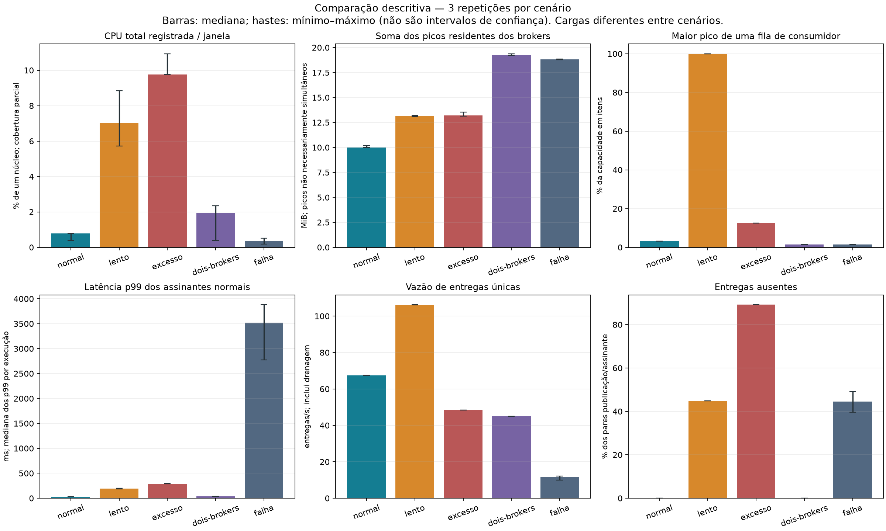

# Resultados finais — 23/11/2026

Este é o lote final da avaliação, com **15 execuções: três repetições de cada um dos cinco cenários**. A rodada piloto não faz parte desta pasta. Os arquivos de medição, configuração e análise foram preservados como produzidos na coleta.

Comece pelo [resumo para o grupo](RESUMO-PARA-O-GRUPO.md) ou pela [análise completa](ANALISE.md).

## Gráficos, dados e configuração

| Arquivo | Para que serve |
| --- | --- |
| [ANALISE.md](ANALISE.md) | Tabela comparativa, interpretação e limites. |
| [comparativo.csv](comparativo.csv) | Uma linha por execução, para conferir os números dos gráficos. |
| [comparativo.json](comparativo.json) | Inclui a cobertura de CPU de cada broker. |
| [comparativo.png](comparativo.png) e [comparativo.svg](comparativo.svg) | Figura comparativa para apresentação. |
| [configuracao.json](configuracao.json) | Clientes, taxas, duração, filas, limites e três repetições. |
| [manifesto.json](manifesto.json) | Ambiente, versão Go, ordem, comandos e hashes registrados na coleta. |
| [fonte.patch](fonte.patch) | Alterações sobre a revisão base usada para compilar os programas medidos. |
| [metadados-analise.json](metadados-analise.json) | Versões e hash do script usado na geração da análise. |
| [VERIFICACAO.md](VERIFICACAO.md) e [verificacao-artefatos.json](verificacao-artefatos.json) | Verificação dos testes, dados, limites e fórmulas. |
| [relatorio-comparativo.html](relatorio-comparativo.html) | Relatório estático; baixe a pasta e abra localmente. |

## Execuções por cenário

| Cenário | Repetição 1 | Repetição 2 | Repetição 3 | Série da primeira repetição |
| --- | --- | --- | --- | --- |
| Normal | [Dados](normal/repeticao-01/) | [Dados](normal/repeticao-02/) | [Dados](normal/repeticao-03/) | [Gráfico](series-normal-01.png) |
| Consumidor lento | [Dados](lento/repeticao-01/) | [Dados](lento/repeticao-02/) | [Dados](lento/repeticao-03/) | [Gráfico](series-lento-01.png) |
| Excesso de envio | [Dados](excesso/repeticao-01/) | [Dados](excesso/repeticao-02/) | [Dados](excesso/repeticao-03/) | [Gráfico](series-excesso-01.png) |
| Dois brokers | [Dados](dois-brokers/repeticao-01/) | [Dados](dois-brokers/repeticao-02/) | [Dados](dois-brokers/repeticao-03/) | [Gráfico](series-dois-brokers-01.png) |
| Falha de broker | [Dados](falha/repeticao-01/) | [Dados](falha/repeticao-02/) | [Dados](falha/repeticao-03/) | [Gráfico](series-falha-01.png) |

Cada repetição contém resumo.json, intervalos.csv, filas-clientes.csv, broker-N.csv, contadores finais, comandos e logs. Nas séries, o tempo é relativo ao início da carga e inclui a drenagem. Há gráficos das outras repetições na raiz desta pasta.

## O que os resultados permitem afirmar

No cenário normal foram 270 entregas e nenhuma ausência em cada repetição. Com dois brokers foram 180 entregas e nenhuma ausência. No cenário lento uma fila de consumidor chegou ao limite e ocorreram descartes. Os consumidores normais também apresentaram aumento de p99 nesse caso; a carga e o buffer diferem entre os cenários, então não se pode atribuir o aumento somente ao consumidor lento.

No excesso, o cliente ignora o limitador local para testar a proteção do broker. Na falha, houve retomada no sobrevivente com interrupção e ausências. Não foram detectadas duplicatas nas 15 execuções; a contagem foi verificada separadamente por injeção controlada no teste automatizado.

As barras mostram mediana e as hastes mínimo–máximo das três execuções, não intervalos de confiança. CPU tem cobertura de amostragem explícita; RAM agregada soma picos por processo, que podem não ser simultâneos. Ausências não são sinônimo de perda de rede. O lote é curto e local, sem comprovação de capacidade de produção ou isolamento perfeito.

Para repetir a coleta em uma pasta nova, siga o [guia da avaliação](../README.md). Os caminhos e hashes do manifesto registram o ambiente original; não substitua seus valores ao consultar o lote publicado.
